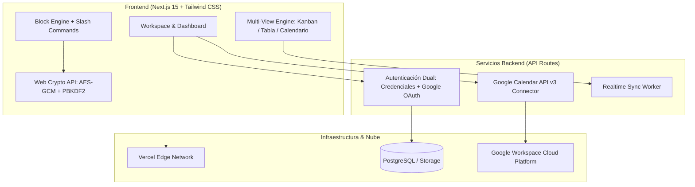

# 🚀 AgendAR
 
[](https://github.com/rapabru/agendAR/releases)
[](https://github.com/rapabru/agendAR)
[](https://agendar-one.vercel.app)
[](https://supabase.com)
[](LICENSE)

> **El espacio de trabajo colaborativo todo-en-uno con diseño moderno Obsidian Dark, tipografía Plus Jakarta Sans, notas estructuradas basadas en bloques, bases de datos relacionales sin código, sincronización bidireccional con Google Calendar y Bóvedas con encriptación de grado militar (Zero-Knowledge / E2EE).**

---

## 🌟 Características Principales

### 📝 1. Editor Dinámico Basado en Bloques (Estilo Notion)
- **Bloques Modulares**: Encabezados (H1, H2, H3), párrafos dinámicos, listas de tareas (To-Do), llamadas destacadas (*Callouts* con emojis), bloques de código con resaltado sintáctico, y bloques especiales de integración.
- **Comandos Rápidos Slash (`/`)**: Escribe `/` en cualquier bloque para desplegar el selector contextual y transformar o insertar elementos al instante.
- **Jerarquía Infinita**: Crea páginas dentro de páginas con navegación en árbol, migas de pan (*breadcrumbs*) y accesos directos a favoritos.
- **Reordenamiento Intuitivo**: Control de posición vertical para estructurar ideas con fluidez.

### 📅 2. Integración Nativa con Google Calendar
- **Sincronización Bidireccional**: Crea tareas, reuniones o eventos en tus notas y proyéctalos directamente a tu calendario de Google.
- **Detección Automática de Fechas**: Asignación de fecha, hora y recordatorio con actualización en tiempo real mediante Google Calendar API v3.
- **Gestión de Cuentas Google**: Vinculación y desvinculación rápida mediante OAuth 2.0.

### 🔐 3. Seguridad Avanzada y Bóvedas Cifradas (Zero-Knowledge / E2EE)
- **Cifrado en Tránsito y Reposo**: Protección estándar con TLS 1.3 y AES-256 en toda la infraestructura.
- **Bóvedas Privadas (End-to-End Encryption)**: Las páginas marcadas como "Bóveda" se cifran y descifran exclusivamente en el navegador del usuario utilizando la **Web Crypto API** con **AES-GCM (256 bits)** y derivación de clave **PBKDF2** (SHA-256, 100.000 iteraciones). Ni el servidor ni intermediarios tienen acceso al contenido sin la clave maestra.

### 📊 4. Bases de Datos Dinámicas y Multi-Vista
- **Tablero Kanban**: Visualiza y gestiona flujos de trabajo arrastrando tarjetas por estado (*Por Hacer*, *En Progreso*, *Completado*).
- **Vista Tabla (Data Grid)**: Edición inline de atributos, prioridades, fechas y estados.
- **Proyección Temporal**: Vista de calendario integrado para seguimiento de fechas límite.
- **Filtros en Tiempo Real**: Búsqueda y filtrado instantáneo de elementos.

### 🤖 5. Inteligencia Artificial Multi-Modelo (BYOK - Bring Your Own Key)
- Motor compatible con:
  - **Google Gemini** (Gemini 1.5/2.5 Flash & Pro) — con soporte para el plan gratuito de Google AI Studio.
  - **Anthropic Claude** (Claude 3.5/3.7 Sonnet)
  - **OpenAI / Codex** (GPT-4o)
- Capacidad de generar planes completos estructurados en bloques a partir de un solo prompt.

### 📚 6. Creación Asistida con Plantillas Predeterminadas (Estilo Notion)
- **Hub de Nueva Página (`NewPageModal`)**: Al hacer clic en `+` o "Añadir una página" en la barra lateral, se despliega un selector interactivo para iniciar con un lienzo en blanco, una bóveda cifrada, asistencia de IA o cualquiera de las plantillas predeterminadas estructuradas.
- **Selector Contextual en Páginas Vacías**: Si abres una página en blanco, el editor despliega tarjetas con las plantillas más populares para aplicarlas al instante con 1 solo clic.
- **Biblioteca de Plantillas Integrada**:
  - *Planificador Semanal & Timeblocking* (vinculado a Google Calendar).
  - *Roadmap Ágil de Software & Sprints* (con tablero Kanban).
  - *Monitor de Hábitos y Metas Diarias*.
  - *Minuta de Reunión & Acuerdos*.
  - *Metas & Objetivos Trimestrales (OKRs)*.
  - *Apuntes de Estudio & Resumen Académico* (Método Cornell).
  - *Bóveda de Seguridad & Credenciales (E2EE con AES-256)*.
  - *CRM de Clientes & Oportunidades*.

### 👥 7. Proyectos Privados y Colaboración Multiusuario
- Modal para alternar entre **Proyecto Privado** (visible solo para el creador) y **Compartido con el Workspace**.
- Sistema de invitaciones por email y generación de enlaces para unirse con roles (*Owner, Admin, Editor, Lector*).
- Migraciones preparadas para PostgreSQL en Supabase con Row-Level Security (RLS).

---

## 🏛️ Arquitectura del Sistema



---

## 🛠️ Stack Tecnológico

| Componente | Tecnología | Uso |
| :--- | :--- | :--- |
| **Framework** | [Next.js 15 (App Router)](https://nextjs.org/) | Renderizado híbrido, API Routes y arquitectura modular |
| **Lenguaje** | [TypeScript](https://www.typescriptlang.org/) | Tipado estricto y seguridad en tiempo de compilación |
| **Estilos & UI** | [Tailwind CSS](https://tailwindcss.com/) | Sistema Obsidian Dark & Glassmorphism con halos luminosos |
| **Tipografía** | [Plus Jakarta Sans](https://fonts.google.com/specimen/Plus+Jakarta+Sans) & [JetBrains Mono](https://www.jetbrains.com/lp/mono/) | Fuentes optimizadas sin CLS vía `next/font/google` |
| **Iconografía** | [Lucide React](https://lucide.dev/) | Iconos vectoriales con contenedores brillantes (*icon wells*) |
| **Criptografía** | [Web Crypto API](https://developer.mozilla.org/es/docs/Web/API/Web_Crypto_API) | Cifrado E2EE cliente sin dependencias pesadas |
| **Integraciones** | Google Calendar API v3 | Sincronización de eventos y tareas |
| **Despliegue** | [Vercel](https://vercel.com/) | Hosting continuo con soporte CI/CD |

---

## 📦 Instalación y Desarrollo Local

### Prerrequisitos
- Node.js 18.x o superior (Recomendado v20+ o v22)
- npm o pnpm

### Pasos

1. **Clonar el repositorio**:
   ```bash
   git clone https://github.com/rapabru/agendAR.git
   cd agendAR
   ```

2. **Instalar dependencias**:
   ```bash
   npm install
   ```

3. **Iniciar servidor de desarrollo**:
   ```bash
   npm run dev
   ```

4. Abrir en el navegador [http://localhost:3000](http://localhost:3000).

---

## 🗺️ Roadmap de Fases
- [x] **Fase 0**: Arquitectura modular, setup Next.js 15, Tailwind y tipos core.
- [x] **Fase 1**: Motor criptográfico AES-GCM-256 E2EE, Google Calendar Sync y vistas de login/registro.
- [x] **Fase 2**: Editor de bloques con barra Slash (`/`), Bóvedas privadas y base de datos Kanban/Tabla.
- [x] **Fase 3**: Persistencia completa y schema para PostgreSQL en Supabase + RLS para proyectos privados.
- [x] **Fase 4**: Asistente de IA multi-proveedor con BYOK (Gemini gratis, Claude, OpenAI) para generación de notas y bloques.
- [x] **Fase 5**: Galería de 6 plantillas profesionales integradas (Scrum, Timeblocking, Hábitos, Minutas, Bóvedas, CRM).
- [x] **Fase 6**: Conexión activa con cuenta Supabase en producción mediante variables de entorno en Vercel.
- [ ] **Fase 7**: Colaboración multijugador en vivo con cursores compartidos (WebSockets / Supabase Realtime / CRDTs).

---

## 📄 Licencia

Este proyecto está bajo la licencia MIT.
