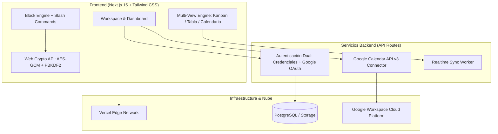

# 🚀 AgendAR

> **El espacio de trabajo colaborativo todo-en-uno que combina notas estructuradas basadas en bloques, bases de datos relacionales sin código, sincronización bidireccional con Google Calendar y Bóvedas con encriptación de grado militar (Zero-Knowledge / E2EE).**

---

## 🌟 Características Principales

### 📝 1. Editor Dinámico Basado en Bloques (Estilo Notion)
- **Bloques Modulares**: Encabezados (H1, H2, H3), párrafos dinámicos, listas de tareas (To-Do), llamadas destacadas (*Callouts* con emojis), bloques de código con resaltado sintáctico, y bloques especiales de integración.
- **Comandos Rápidos Slash (`/`)**: Escribe `/` en cualquier bloque para desplegar el selector contextual y transformar o insertar elementos al instante.
- **Jerarquía Infinita**: Crea páginas dentro de páginas con navegación en árbol, migas de pan (*breadcrumbs*) y accesos directos a favoritos.
- **Reordenamiento Intuitivo**: Control de posición vertical para estructurar ideas con fluidez.

### 📅 2. Integración Nativa con Google Calendar
- **Sincronización Bidireccional**: Crea tareas, reuniones o eventos en tus notas y proyéctalos directamente a tu calendario de Google.
- **Detección Automática de Fechas**: Asignación de fecha, hora y recordatorio con actualización en tiempo real mediante Google Calendar API v3.
- **Gestión de Cuentas Google**: Vinculación y desvinculación rápida mediante OAuth 2.0.

### 🔐 3. Seguridad Avanzada y Bóvedas Cifradas (Zero-Knowledge / E2EE)
- **Cifrado en Tránsito y Reposo**: Protección estándar con TLS 1.3 y AES-256 en toda la infraestructura.
- **Bóvedas Privadas (End-to-End Encryption)**: Las páginas marcadas como "Bóveda" se cifran y descifran exclusivamente en el navegador del usuario utilizando la **Web Crypto API** con **AES-GCM (256 bits)** y derivación de clave **PBKDF2** (SHA-256, 100.000 iteraciones). Ni el servidor ni intermediarios tienen acceso al contenido sin la clave maestra.

### 📊 4. Bases de Datos Dinámicas y Multi-Vista
- **Tablero Kanban**: Visualiza y gestiona flujos de trabajo arrastrando tarjetas por estado (*Por Hacer*, *En Progreso*, *Completado*).
- **Vista Tabla (Data Grid)**: Edición inline de atributos, prioridades, fechas y estados.
- **Proyección Temporal**: Vista de calendario integrado para seguimiento de fechas límite.
- **Filtros en Tiempo Real**: Búsqueda y filtrado instantáneo de elementos.

### 🤖 5. Inteligencia Artificial Multi-Modelo (Próximamente / BYOK)
- Conexión de claves propias (*Bring Your Own Key*) para interactuar con:
  - **Google Gemini** (Gemini 2.5 / 1.5 Pro & Flash)
  - **Anthropic Claude** (Claude 3.7 Sonnet / Opus)
  - **OpenAI / Codex** (GPT-4o)
- Generación de resúmenes, lluvia de ideas, autocompletado de bloques y creación automática de plantillas.

---

## 🏛️ Arquitectura del Sistema



---

## 🛠️ Stack Tecnológico

| Componente | Tecnología | Uso |
| :--- | :--- | :--- |
| **Framework** | [Next.js 15 (App Router)](https://nextjs.org/) | Renderizado híbrido, API Routes y arquitectura modular |
| **Lenguaje** | [TypeScript](https://www.typescriptlang.org/) | Tipado estricto y seguridad en tiempo de compilación |
| **Estilos** | [Tailwind CSS](https://tailwindcss.com/) | Diseño responsivo con estética Notion Dark |
| **Iconografía** | [Lucide React](https://lucide.dev/) | Iconos vectoriales consistentes |
| **Criptografía** | [Web Crypto API](https://developer.mozilla.org/es/docs/Web/API/Web_Crypto_API) | Cifrado E2EE cliente sin dependencias pesadas |
| **Integraciones** | Google Calendar API v3 | Sincronización de eventos y tareas |
| **Despliegue** | [Vercel](https://vercel.com/) | Hosting continuo con soporte CI/CD |

---

## 📦 Instalación y Desarrollo Local

### Prerrequisitos
- Node.js 18.x o superior (Recomendado v20+ o v22)
- npm o pnpm

### Pasos

1. **Clonar el repositorio**:
   ```bash
   git clone https://github.com/rapabru/agendAR.git
   cd agendAR
   ```

2. **Instalar dependencias**:
   ```bash
   npm install
   ```

3. **Iniciar servidor de desarrollo**:
   ```bash
   npm run dev
   ```

4. Abrir en el navegador [http://localhost:3000](http://localhost:3000).

---

## 🗺️ Roadmap de Próximas Fases

- [x] **Fase 0**: Arquitectura modular, setup Next.js 15, Tailwind y tipos core.
- [x] **Fase 1**: Motor criptográfico AES-GCM-256 E2EE, Google Calendar Sync y vistas de login/registro.
- [x] **Fase 2**: Editor de bloques con barra Slash (`/`), Bóvedas privadas y base de datos Kanban/Tabla.
- [ ] **Fase 3**: Persistencia completa en PostgreSQL (Prisma/Drizzle) + invitaciones multiusuario a Workspaces.
- [ ] **Fase 4**: Colaboración multijugador en tiempo real con WebSockets / CRDTs (Yjs).
- [ ] **Fase 5**: Integración de Modelos IA (Gemini, Claude, Codex) con BYOK.
- [ ] **Fase 6**: Galería extensa de plantillas preconfiguradas y personalizables.

---

## 📄 Licencia

Este proyecto está bajo la licencia MIT.
